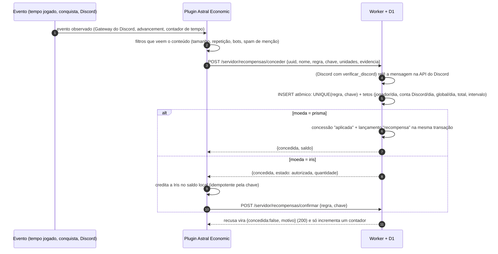

# Prisma e recompensas — infraestrutura do Worker (moeda de cosméticos)

Estado: **código e testes na branch `prisma-infra`; nada aplicado em produção, nada publicado.** Pacotes aprovados e preços de pet em Prisma (100 por pet) já estão no catálogo (inativos). Regras Iris aprovadas estão em configuração SQL local, também inativas; não há tela no site. Três interruptores independentes, todos ausentes hoje: `PRISMA_ATIVO = "sim"` (compra e saldo), `PRISMA_GASTOS_ATIVO = "sim"` (gasto em cosméticos) e `RECOMPENSAS_ATIVO = "sim"` (concessões). Sem eles o comportamento é o de hoje (rotas 404 ou recusa).

## Catálogo aprovado (migração `0004_prisma_pacotes.sql`)

Aprovado pelo usuário em 2026-11-07 (escolha de UI 31f12332). Preço e quantidade vivem **só no D1**; o navegador manda apenas o id.

| id | Pacote | Preço | R$ por Prisma | Bônus vs. entrada |
| --- | --- | --- | --- | --- |
| `prisma_100` | 100 Prisma | R$ 9,90 | 0,0990 | — |
| `prisma_275` | 275 Prisma | R$ 24,90 | 0,0905 | −8,5% |
| `prisma_600` | 600 Prisma | R$ 49,90 | 0,0832 | −16% |

- Nascem `ativo = 0` e `preco_confirmado = 1`. Abrir a venda é deliberado: `PRISMA_ATIVO = "sim"` + `UPDATE prisma_pacotes SET ativo = 1, atualizado_em = unixepoch() WHERE id IN ('prisma_100','prisma_275','prisma_600');`. Em modo real ainda exige `LOJA_VENDAS_REAIS = "sim"`; `LOJA_PAUSADA` bloqueia.
- **Pets: 100 Prisma por pet aprovado; cosméticos futuros ainda sem preço.** O gasto fica atrás de `PRISMA_GASTOS_ATIVO`: ausente, `POST /servidor/prisma/gastar` responde `403 gastos_desativados`, sem tocar no saldo. Abertura das vendas segue dependendo da aprovação final.
- `GET /api/prisma/pacotes` (sem sessão, exige `PRISMA_ATIVO`) devolve `{modo, gastos_ativos, pacotes[{id,nome,quantidade,preco_centavos,moeda,preco_de_teste,a_venda}]}` só com pacotes ativos, para a página mostrar o catálogo antes de vincular a conta. `GET /api/prisma` (com sessão) também traz `gastos_ativos`.
- Prisma fica no D1 (livro-razão); a Iris continua separada e fora do Worker.

Decisão do usuário (2026-11-07): **Prisma** entra por **compra na loja e por recompensas** e só compra cosméticos. **Iris** entra por **tempo ativo, conquistas e interações no Discord** e circula **somente entre jogadores**. Os valores Iris aprovados no bloco `9f8e5a81` estão na seção de configuração local abaixo. Transferências Iris ficam no plugin, **sem limite diário e sem taxa**, com confirmação e idempotência. O Worker **nunca guarda saldo de Iris** (é local do plugin): para a Iris ele só autoriza, limita e audita a concessão. Não existe rota de transferência, saque ou conversão Prisma↔Iris.

Nome do plugin: **Astral Economic** (antes AstralLoja; repo próprio, a cargo da Kuromi). O Worker não depende do nome do plugin (só do HMAC); ver [Compatibilidade com o renome](#compatibilidade-com-o-renome).

## Mapa de fluxo

```mermaid
sequenceDiagram
  autonumber
  participant J as Jogador (site)
  participant W as Worker astral-loja + D1
  participant MP as Mercado Pago
  participant P as Plugin Astral Economic (Paper; antes AstralLoja)
  Note over J,W: Compra de pacote (conta já vinculada pelo código do jogo)
  J->>W: POST /api/prisma/pedidos {pacote_id}
  W->>W: copia quantidade e preço do pacote para prisma_pedidos
  W->>MP: preferência Checkout Pro (external_reference = prisma:<pedido>)
  W-->>J: checkout_url
  J->>MP: paga (Pix ou cartão)
  MP->>W: webhook assinado (data.id)
  W->>MP: GET /v1/payments/{id}
  W->>W: confere conta, referência, moeda, valor, live_mode
  W->>W: lançamento "credito" (livro-razão, UNIQUE ref)
  Note over P,W: Compra de cosmético no jogo (o preço em Prisma é do plugin)
  P->>W: POST /servidor/prisma/gastar {uuid, quantidade, ref, item} (HMAC)
  W->>W: INSERT condicionado ao saldo (atômico)
  W-->>P: 200 {saldo} ou 409 saldo_insuficiente
  P->>P: aplica o cosmético e grava local
  P-->>W: se não conseguiu aplicar: POST /servidor/prisma/estornar {ref}
  P->>W: ao entrar / a cada 30 min: GET /servidor/prisma/jogador/{uuid} (saldo + itens comprados)
```

### Estados do pedido e efeito no saldo (mesma política dos pets)

| Mercado Pago | `prisma_pedidos.estado` | Livro-razão |
| --- | --- | --- |
| `approved` e tudo confere | `pago` | `credito` +quantidade (uma vez) |
| `approved` com valor, moeda, conta ou modo divergente | `divergente` | nada; evento para a equipe |
| `pending` / `in_process` / `authorized` | `aguardando_pagamento` | nada |
| `rejected` / `cancelled` antes de aprovar | `recusado` / `cancelado` | nada |
| `in_mediation` (contestação aberta) | `em_disputa` | `retencao` −quantidade (o crédito fica preso) |
| volta a `approved` depois da disputa | `pago` | `liberacao` +quantidade |
| `refunded` total / `cancelled` depois de aprovar | `reembolsado` / `cancelado` | `reversao` −min(efeito do pedido, saldo disponível); o que já foi gasto vira **caso** (abaixo) |
| `charged_back` | `contestado` | igual: `reversao` do que existe + caso |
| reembolso parcial | `pago` | saldo mantido; abre **caso** `reembolso_parcial` (sem ação) |
| segundo pagamento aprovado do mesmo pedido | sem mudança | nada; evento `reembolsar_manual` |

O saldo é `SUM(quantidade)` do jogador em `prisma_lancamentos` (só cresce; nunca UPDATE/DELETE). Não há saldo guardado que possa divergir. Gasto com saldo insuficiente é recusado. **O Worker nunca deixa o saldo negativo por conta própria** (veja "Reembolso, contestação e chargeback: casos").

## Esquema (`worker/migrations/loja/0003_prisma.sql`)

Adiciona tabelas (0003: pacotes, pedidos, livro-razão, recompensas e casos; 0005: preços de pet em Prisma; 0006: snapshots e disjuntor Iris) e a coluna opcional `advancement_id` em regras/concessões com índice vitalício; não altera `produtos`, `pedidos`, `direitos`, `entregas` nem `pagamentos`.

| Tabela | Papel |
| --- | --- |
| `prisma_pacotes` | catálogo (id `prisma_*`, quantidade, preço em centavos, `ativo`, `preco_confirmado`). **Nasce vazia.** |
| `prisma_pedidos` | um pedido = uma preferência; copia quantidade e preço no momento da compra |
| `prisma_lancamentos` | livro-razão: `credito`, `recompensa`, `retencao`, `liberacao`, `reversao`, `gasto`, `compra`, `estorno`, `ajuste`. `ref` UNIQUE = idempotência; CHECK impede sinal errado |
| `prisma_casos` (0003) | casos de reembolso/contestação/chargeback para revisão humana (um por pedido, UNIQUE) |
| `prisma_precos` (0005) | preço em Prisma dos pets (`produto_id`, `preco_prisma` 1..100000, `ativo`); 7 pets a 100, todos `ativo = 0` |

Por que não reaproveitar `pedidos`/`produtos`: `produtos.tipo` tem CHECK fechado (`pet`, `apoio`, `apoio_mensal`) e `pedidos.produto_id` aponta para ele. Recriar `produtos` de novo (como na 0002, que já falhou uma vez em produção por causa das chaves estrangeiras) mexeria no caminho que vende de verdade. Tabelas novas = zero risco para as compras atuais. O pagamento do Prisma entra em `pagamentos` com `pedido_id NULL` (a ligação fica em `prisma_pedidos.pagamento_id`).

Por que o saldo não usa `direitos`/`entregas`: elas modelam **estado** de um produto (liberar/suspender/revogar). Prisma é **quantidade** consumível; precisa de livro-razão. Já o **pet comprado com Prisma** é um direito de catálogo e usa exatamente `pedidos` + `direitos` + `entregas` (veja a seção seguinte).

## Pets e cosméticos comprados com Prisma (decisão do usuário)

- **Preço inicial dos pets: 100 Prisma** (= o pacote de R$ 9,90), em `prisma_precos`, só do banco. O navegador e o plugin mandam só `produto_id` + `ref`.
- **Compra em reais continua igual.** Prisma é uma segunda forma de pagar o mesmo pet; os dois caminhos acabam no mesmo `aplicarDireito` e, portanto, na mesma entrega `liberar` para o plugin. Quem já tem o pet (ativo ou suspenso) recebe `409 ja_possui` em qualquer um dos dois jeitos de pagar.
- **Saldo único.** Prisma comprado e Prisma ganho como recompensa são o mesmo saldo (decisão 5).
- **`comprar` (`POST /servidor/prisma/comprar` e `POST /api/prisma/comprar-pet`)** exige `PRISMA_ATIVO` **e** `PRISMA_GASTOS_ATIVO` (ambos ausentes hoje), `prisma_precos.ativo = 1`, `produtos.ativo = 1` e loja não pausada. Passos:
  1. **A, uma transação (`DB.batch`)**: lançamento `compra` −preço (`INSERT … SELECT … WHERE saldo ≥ preço AND o jogador ainda não tem o pet`) + `pedidos` `pp-<ref>` com `moeda = 'PRISMA'`, `estado = 'pago'`, `valor_centavos` = preço em **Prisma** (não é dinheiro), sem `pagamento_id`.
  2. **B, `aplicarDireito`**, só se o pedido ainda não deixou histórico de direito (repetir a mesma `ref` completa o que ficou pela metade e nunca duplica). Se outro pedido ficou com o pet entre A e B (corrida com a compra em reais), o débito é desfeito por `estorno` (`estorno-compra:<ref>`), o pedido vira `cancelado` e a resposta é `409 ja_possui`; o direito do outro pedido não é tocado.
  3. O cron (a cada 10 min) completa compras com débito e pedido gravados mas sem direito (queda entre A e B, pedidos com mais de 2 min).
- Respostas do servidor: `200 {ok, repetido, saldo, preco, produto_id}`; erros `403 gastos_desativados/loja_pausada`, `404 produto_sem_preco`, `409 ja_possui/saldo_insuficiente {saldo, preco}/ref_em_uso/preco_divergente {preco}`, `400 uuid_invalido/ref_invalida/produto_invalido/preco_esperado_invalido`. `preco_esperado` (opcional, inteiro) é o preço que o jogador viu: se o banco mudou, a primeira compra recusa com `preco_divergente` sem cobrar; repetir uma ref já comprada devolve o resultado original. No site a `ref` é gerada no servidor (um clique = uma compra) e a rota é limitada a 20/hora por jogador.
- **Cosméticos futuros** (não são direitos do catálogo) continuam em `gastar`: o plugin define o item e o preço e concede localmente (decisão 1). Só pet usa `comprar`. O plugin escolhe a rota pelo tipo: pet → `comprar` (a entrega `liberar` chega pela fila de sempre); demais cosméticos → `gastar`.
- `pedidos` passa a ter linhas de moeda `PRISMA`. `GET /api/conta` lista só `moeda = 'BRL'` (para o front não mostrar Prisma como reais). **Qualquer relatório financeiro que some `pedidos.valor_centavos` precisa filtrar `moeda = 'BRL'`.**
- Painel/catálogo público trazem `pets[{produto_id, nome, preco_prisma, possui}]` só dos preços ativos.

## Reembolso, contestação e chargeback: casos (decisão do usuário: analisar caso a caso)

Regras: o Worker **nunca revoga cosmético**, **nunca cria dívida** e **nunca deixa o saldo negativo** por conta própria. Em reembolso total, cancelamento depois de aprovado, chargeback ou contestação:

1. retira do saldo **só o que ainda existe**: `min(efeito líquido do pedido, max(saldo, 0))`, como `reversao` (ou `retencao` na contestação);
2. se sobrou diferença (Prisma que já foi gasta), registra em `prisma_casos` (`quantidade_revertida`, `quantidade_pendente`, `estado = aberto`) e escreve o evento `caso_aberto:<tipo>:pendente=N` em `eventos_pagamento`;
3. **age uma vez por pedido**: uma contestação seguida de chargeback só *escala o tipo* do caso e o reabre; o `pendente` nunca é cobrado depois (nem com Prisma nova), porque cobrar é decisão humana;
4. se a loja vence a disputa (volta a `approved`), o Worker devolve o retido (`liberacao`) e fecha o caso como `resolvido / voltou_a_pago`;
5. **reembolso parcial** mantém o saldo e só abre um caso `reembolso_parcial` (sem ação).

Prisma ganha como recompensa que sobrou no saldo não é confiscada além do efeito do próprio pedido (limite = o que o pedido creditou).

Revisão pela equipe:
- `GET /servidor/prisma/casos?apos={id}` → `{casos[{id, pedido_id, uuid, tipo, quantidade_pedido, quantidade_revertida, quantidade_pendente, acao_aplicada, estado, nota, saldo, itens[{item_id, preco, ref}]}]}` (abertos e em análise, até 50) — o plugin/painel pode avisar a equipe. Pets comprados com Prisma não entram em `itens` (são direitos); consultar `pedidos` com `moeda = 'PRISMA'` e `direitos`.
- `POST /servidor/prisma/casos/atualizar {id, estado: aberto|em_analise|resolvido, resolucao?, nota?}` (resolver exige `resolucao`, até 500 caracteres). **Só muda o andamento do caso**; não mexe em saldo nem em cosmético.
- Ações financeiras da equipe continuam manuais, por SQL, com detalhe: `ajuste` (cobrar ou perdoar saldo), `estornar`, ou revogar um direito. Nada disso é automático.

## Endpoints

Todos exigem `PRISMA_ATIVO = "sim"`; senão `404 {"erro":"prisma_desativado"}`.

**Site** (sessão `Authorization: Bearer`, CORS como o resto):

| Rota | Resposta |
| --- | --- |
| `GET /api/prisma` | `{modo, gastos_ativos, saldo, pacotes[{id,nome,quantidade,preco_centavos,moeda,preco_de_teste,a_venda}], pets[{produto_id,nome,preco_prisma,possui}], extrato[20 últimos]}` |
| `GET /api/prisma/pacotes` | público (sem sessão): pacotes e `pets` com preço em Prisma |
| `POST /api/prisma/comprar-pet {produto_id, preco_esperado?}` | `{ok, repetido, saldo, preco, produto_id}`; erros como `comprar`, inclusive `409 preco_divergente {preco}` sem cobrar |
| `POST /api/prisma/pedidos {pacote_id}` | `{pedido_id, checkout_url}` (reaproveita pedido aberto igual). Erros: `pacote_invalido` 400, `produto_indisponivel` 404/403, `loja_pausada`, `vendas_reais_desativadas`, `preco_nao_confirmado` 403, `muitas_tentativas` 429 |
| `GET /api/prisma/pedidos/{id}` | `{id, pacote_id, quantidade, valor_centavos, estado, saldo}` |

**Servidor do jogo** (mesmo HMAC das rotas `/servidor/*` de hoje: `METHOD\ncaminho+query\nts\nnonce\nsha256(corpo)`):

| Rota | Corpo | Resposta |
| --- | --- | --- |
| `POST /servidor/prisma/gastar` | `{uuid, quantidade (inteiro 1..100000), ref (8–80 de [A-Za-z0-9_:.-]), item ([a-z0-9_]{2,48})}` | `200 {ok, repetido, saldo}`; `409 saldo_insuficiente {saldo}`; `409 ref_em_uso` (mesma ref com dados diferentes); `409 ref_estornada`; `400 uuid_invalido/quantidade_invalida/ref_invalida/item_invalido` |
| `POST /servidor/prisma/estornar` | `{ref}` | `200 {ok, repetido, saldo}`; `404 gasto_inexistente` |
| `POST /servidor/prisma/comprar` | `{uuid, produto_id, ref, preco_esperado?}` (pet) | `200 {ok, repetido, saldo, preco, produto_id}`; erros na seção de pets |
| `GET /servidor/prisma/precos` | — | `{gastos_ativos, pets[{produto_id, nome, preco_prisma, possui:false}]}` (preços ativos, para o plugin mostrar o valor antes de comprar) |
| `GET /servidor/prisma/casos?apos={id}` · `POST /servidor/prisma/casos/atualizar` | veja a seção de casos | revisão humana |
| `GET /servidor/prisma/jogador/{uuid}` | — | `{uuid, saldo, itens[{item_id, preco, ref, criado_em}]}` (gastos não estornados) |
| `GET /servidor/prisma/novos?apos={id}` | — | `{lancamentos[{id,uuid,tipo,quantidade}]}` (créditos/retenções/reversões/ajustes, até 100) para avisar quem está online |

### Contrato para o plugin (Kuromi)

1. **Saldo e posse de cosméticos comprados com Prisma são do Worker.** O plugin guarda no máximo cache. Ao entrar e a cada 30 min, `GET /servidor/prisma/jogador/{uuid}` e concede localmente qualquer `item_id` que falte. **Não revogar automaticamente** (veja decisão 3).
2. **Compra de pet:** ler `GET /servidor/prisma/precos` e enviar `POST /servidor/prisma/comprar {uuid, produto_id, ref, preco_esperado}` com o preço exibido. O campo é opcional para clientes antigos; o cliente atualizado deve enviá-lo. A entrega `liberar` chega pela fila de sempre (não conceder localmente). **Compra de outro cosmético:** o plugin decide o preço em Prisma (o Worker só debita o número que recebe, assinado). Gera `ref` única por tentativa (ex.: UUID v4), **grava a intenção localmente antes de chamar** e chama `gastar`. Só aplica o cosmético com `200`. Se não conseguir aplicar, chama `estornar` com a mesma `ref`.
3. **Retentativa:** em timeout, 5xx ou queda, repetir **a mesma `ref`** (resposta idêntica, sem gastar de novo). Em `ref_em_uso`/`ref_estornada`, gerar `ref` nova.
4. Mostrar o saldo vindo de `gastar`/`jogador`; em `saldo_insuficiente` o corpo traz o saldo atual.
5. Avisos de crédito: `GET novos?apos=` guardando o último `id` visto (pode pegar carona no ciclo de 10 s que já existe).
6. A ação `liberar/suspender/revogar` da fila `/servidor/entregas` **não** é usada para Prisma.
7. Prisma não pode entrar em nenhum comando/permissão de Iris (compra, troca ou pagamento), e Iris não é enviada ao Worker como saldo.

### Leitura do preço de pets e revisão do canal do site

`GET /servidor/prisma/precos` usa autenticação HMAC das rotas do servidor (sem corpo; versão 2 ou legado). Sem HMAC, inclusive com sessão de navegador, responde 401. Com `PRISMA_ATIVO` ausente, responde 404. Exemplo quando somente o gato estiver ativo:

```json
{"gastos_ativos":true,"pets":[{"produto_id":"pet_gato","nome":"Gato","preco_prisma":100,"possui":false}]}
```

Só aparecem linhas com `prisma_precos.ativo = 1`, `produtos.ativo = 1` e tipo `pet`. O preço é sempre `prisma_precos.preco_prisma`, sem fallback para o config do plugin. `possui:false` nesta leitura é genérico, pois a rota não recebe jogador; não indica ausência do direito de um jogador específico. Conferir posse pelos direitos já sincronizados. Respostas não usam cache HTTP (`Cache-Control: no-store`).

O botão Prisma só fica habilitado após leitura válida, `gastos_ativos = true` e produto presente na lista; erro de leitura, 404 ou produto ausente mantém o botão desabilitado. Reconsultar ao abrir a compra e usar o `preco_prisma` exibido como `preco_esperado`. `409 preco_divergente {preco}` não cobra: atualizar a leitura e pedir nova confirmação antes de uma nova tentativa. Timeout/5xx após envio repete a mesma `ref` e intenção; compra já concluída retorna o preço original, sem novo débito. `403 gastos_desativados/loja_pausada` desabilita a tentativa.

**Revisão do site (código local):** `loja.js` renderiza somente BRL de `/api/catalogo`, usando `preco_centavos`, e envia a compra em reais a `/api/pedidos`/Mercado Pago. Não existe preço ou botão Prisma no frontend ainda. As APIs para essa futura interface já usam o mesmo D1: `/api/prisma/pacotes` (público) e `/api/prisma` (sessão) devolvem os mesmos preços ativos; só a segunda informa posse do jogador. A rota de compra do site aceita `preco_esperado` e protege contra divergência como a do plugin. Não confundir `preco_centavos` (BRL) com `preco_prisma` (unidades Prisma). Testes cobrem alteração do preço no D1, produto/preço inativos, paridade entre APIs, autenticação e catálogo BRL preservado. Aparência da loja não foi validada no navegador nesta revisão.

## Contrato único plugin ↔ Worker (versão 2)

Fonte da verdade: este documento, `ECONOMIA.md` §2.2–2.3 do repo astral-economic e `worker/loja.mjs`/`prisma.mjs`/`recompensas.mjs`. O rascunho de 2026-11-07 do plugin (opção B, `creditar_prisma`/`debitar_prisma` pela fila de entregas) está **superado**: vale a opção A (Prisma autoritativa no D1).

**Avaliação técnica do `X-Astral-Contrato` (decisão: opcional, nada é recusado por falta dele).** Na opção A a Prisma e as recompensas **não usam a fila de entregas**, e não existe ação nova de entrega: um plugin legado não tem como receber nada que não entenda. Logo o cabeçalho **não é necessário hoje** e não deve forçar o plugin a mudar. Ele fica como apólice barata para o dia em que existir uma ação nova na fila legada:

- Contrato 1 = plugin AstralLoja 0.1/0.2 (sem cabeçalho). Contrato 2 = Astral Economic, que **pode** enviar `X-Astral-Contrato: 2` (inteiro 1–999 sem zero à esquerda; senão `400 contrato_invalido`).
- Se enviar, o valor **entra na assinatura** (linha extra no fim do canônico); remover, acrescentar ou trocar o cabeçalho invalida a chamada (`401 assinatura_invalida`), sem rebaixamento silencioso. Sem o cabeçalho o canônico é o de sempre:

```
<METODO>\n<caminho+query>\n<ts>\n<nonce>\n<sha256hex(corpo)>[\ncontrato:<valor>]      ← última linha só quando o cabeçalho é enviado
```

- `/servidor/entregas` só reserva ações registradas em `ACAO_CONTRATO_MINIMO` para o contrato do cliente (hoje `liberar`, `suspender`, `revogar` = contrato 1). Ação **não registrada não é entregue a ninguém** e fica pendente, sem gastar tentativa. Ação nova deve entrar com contrato mínimo ≥ 2.
- Nenhuma rota é recusada por contrato: `/servidor/prisma/*` e `/servidor/recompensas/*` funcionam com ou sem o cabeçalho (só o plugin novo as chama). `GET /servidor/contrato` devolve `{contrato, contrato_atual, prisma, prisma_gastos, recompensas}` para o plugin ver a versão e os interruptores sem tentar às cegas.
- Custo/risco do que ficou: alteração pequena em `autenticarServidor` e um filtro no SELECT de entregas (cobertos pelos 32 testes antigos de pets e apoios). Para desfazer, reverter esse trecho de `loja.mjs`; nada no D1 depende disso.

**Saldo, idempotência, reembolso, reconciliação (opção A).**
- Saldo de Prisma = soma do livro-razão no D1; o plugin não guarda saldo. Gasto/estorno idempotentes por `ref` do plugin; concessão por `(regra, chave)`; crédito de compra por `<pedido>:<seq>`; webhook repetido ou reprocessado do Mercado Pago não duplica nada.
- Reembolso/chargeback **não deixa o saldo negativo** (volta ao rascunho original, "nunca negativo"): retira o que existe, registra o resto como caso para revisão e não revoga cosmético sozinho (decisão do usuário, D3 resolvida: caso a caso).
- Reconciliação: `GET /servidor/prisma/jogador/{uuid}` (saldo + cosméticos comprados e não estornados) ao entrar e periodicamente; `GET /servidor/recompensas/pendentes` para Iris autorizada; cron do Worker reconcilia pagamentos. Não existe rota de "totais por conta": sem livro de Prisma no plugin não há o que comparar.

**Divergências do rascunho já resolvidas:** (1) B → A; (2) `POST /servidor/prisma/conceder` → `POST /servidor/recompensas/conceder` com `{uuid, nome, regra, chave, unidades, evidencia?}`; (3) `parcial` e ids de entrega de Prisma não existem; (4) `evento_discord` como entrega não existe: Discord é `conceder` com evidência `{discord_user_id, canal_id, mensagem_id}`; (5) Iris passa pelo Worker só para autorizar/limitar/auditar (`autorizada` → `confirmar`), nunca guarda saldo; (6) o User-Agent não é lido pelo Worker.

## Recompensas (Prisma e Iris) — `worker/recompensas.mjs`

Motor de concessões **configurável por SQL, sem redeploy, idempotente e auditável**. Requer `RECOMPENSAS_ATIVO = "sim"` e uma regra com `ativo = 1`. **Nenhum valor de fábrica**: `recompensa_regras` nasce vazia e toda regra nasce inativa.

### Configuração local aprovada de Iris (bloco `9f8e5a81`)

`worker/config/recompensas-iris.sql` é uma configuração executável separada das migrações. Foi aplicada somente em SQLite isolado nos testes, depois das migrações. Todas as linhas usam `ativo = 0`; reaplicar preserva regras existentes. Não define flags, canais, teto mensal nem idade máxima.

| Regra / fonte | Valor aprovado | Limite |
| --- | --- | --- |
| `iris_tempo_ativo` / `tempo_jogado` | 10 Iris por unidade de 1800 segundos ativos | 8 unidades = 80 Iris por jogador/dia |
| Uma regra por advancement / `conquista` | Tier 1: 5; tier 2: 15; tier 3: 40 Iris | Uma vez por advancement/jogador, na vida toda |
| `iris_discord_mensagem` / `discord_mensagem` | 2 Iris por mensagem válida | 5 unidades = 10 Iris por jogador e conta Discord/dia |

Tempo ativo e exclusão de AFK são medidos no plugin: o Worker recebe unidades e não consegue verificar atividade pelo relógio. O plugin só fecha uma unidade após 1800 segundos ativos, usa chave estável por janela e envia uma unidade por chamada; não deve converter tempo AFK em recompensa.

Discord usa intervalo técnico de **300 segundos** conforme sugestão do Maestro. A lista de canais começa vazia e recusa tudo até receber ids aprovados. Gateway desligado; somente metadados, sem `MESSAGE_CONTENT` e sem promessa de filtro de texto. `verificar_discord = 0` nesta configuração local; releitura e token dependem de aprovação posterior.

O SQL contém os **15 IDs completos aprovados pelo usuário (proposta do Keroppi)**, com dificuldade **1→5, 2→15, 3→40**: 6 iniciais, 6 intermediários e 3 avançados, total vitalício de **240 Iris/UUID**. Tudo permanece desligado por padrão (`ativo = 0`) até autorização de deploy/ativação. `advancement_id` guarda o ID com namespace; o plugin recebe essa associação no GET regras. Cada regra usa `max_unidades_total = 1`, `max_unidades_dia = 1` e `max_unidades_por_chamada = 1`: o limite diário é redundante com o vitalício e não limita conquistas diferentes no mesmo dia. O índice `UNIQUE(uuid, advancement_id)` em concessões protege também contra regras diferentes para o mesmo ID. Não usar uma regra única por tier. Os 15 IDs foram conferidos novamente no jar vanilla 26.3 local (SHA-256 `4508d006323f24fa02876310c192d739af56516eb259000ac50f0909a68c9a2d`): todos têm display, não são recipes e não têm hidden=true; não foi validado o datapack efetivo de produção.

Transferências Iris não passam por estas regras de emissão: **sem teto diário e sem taxa**, mantendo confirmação e idempotência no plugin. Nenhuma configuração de transferência foi alterada pelo Worker. O disjuntor proporcional (`C_m = 90 × dias × N + R`) foi aprovado pelo usuário e permanece preparado e desligado na migração 0006 até autorização de ativação; nenhum teto estático foi cadastrado.



### Regras (`recompensa_regras`)

| Coluna | Significado |
| --- | --- |
| `id`, `fonte` | nome da regra e origem do evento (ex.: `tempo_jogado`, `conquista`, `discord_mensagem`); fonte que começa com `discord` exige evidência |
| `moeda` | `prisma` ou `iris` |
| `advancement_id` | ID completo (ex.: `minecraft:story/enchant_item`) para conquistas Iris com identidade vitalícia; NULL mantém compatibilidade das regras legadas |
| `quantidade` | por unidade; a concessão grava o total **no momento** (mudar a regra depois não altera o que já foi pago) |
| `max_unidades_por_chamada` | quantas unidades o plugin pode pedir de uma vez (ex.: períodos de tempo acumulados) |
| `max_unidades_dia` | **obrigatório**, por jogador **e por conta Discord** (contra contas alternativas), dia de Brasília |
| `max_unidades_dia_global`, `max_unidades_total`, `intervalo_minimo_segundos` | opcionais: todos os jogadores/dia, vida toda do jogador, espaçamento mínimo |
| `verificar_discord` | 1 = o Worker relê a mensagem na API do Discord (precisa do segredo `DISCORD_BOT_TOKEN`) |
| `idade_maxima_segundos` | `NULL` = sem limite (padrão; **nenhuma regra nasce com limite**, o valor é do usuário). Se preenchido (mínimo 60) e o `conceder` trouxer `ocorrido_em`, evento mais velho que isso é recusado com `evento_antigo` |
| `ativo` | nasce 0 |

Modelo para a equipe (os `<…>` são decisões do dono, não valores meus):

```sql
INSERT INTO recompensa_regras (id, fonte, moeda, quantidade, max_unidades_por_chamada, max_unidades_dia, intervalo_minimo_segundos, ativo, criado_em, atualizado_em)
VALUES ('<id>', '<fonte>', '<prisma|iris>', <quantidade>, <por_chamada>, <teto_dia>, <intervalo>, 0, unixepoch(), unixepoch());
UPDATE recompensa_regras SET ativo = 1, atualizado_em = unixepoch() WHERE id = '<id>';   -- só depois de conferir
```

### Idade do evento (`ocorrido_em` e `idade_maxima_segundos`)

`POST /servidor/recompensas/conceder` aceita `ocorrido_em` (opcional): segundos Unix, inteiro, do momento em que o plugin gravou o evento na fila local; reenvios mantêm o mesmo valor. Inválido (não inteiro, ≤ 0 ou mais de 5 min no futuro) → `400 ocorrido_em_invalido`. Se a regra tiver `idade_maxima_segundos` e `agora − ocorrido_em` passar dele, a resposta é `{concedida:false, motivo:"evento_antigo"}` (definitiva para o evento, contada em `recompensa_recusas`, sem concessão nem queima da chave). Sem o campo, ou regra sem limite, o evento é aceito como antes. Evento já pago segue idempotente. Os tetos diário e mensal continuam contando o dia/mês da **chamada**, não o do evento; o limite de idade é o que impede um atraso longo de empurrar ganho para outro dia. Independente disso, a releitura do Discord (`verificar_discord = 1`) mantém sua própria idade máxima de 15 min. `GET /servidor/recompensas/regras` devolve `idade_maxima_segundos` por regra.

### Allowlist de canais do Discord por regra (`recompensa_canais`)

Regra com `fonte` começando por `discord` **só paga mensagem de canal cadastrado para aquela regra**. Sem nenhum canal cadastrado, a regra não paga (falha fechada: regra de Discord ativada por engano não paga mensagens de qualquer canal). Regras de outras fontes ignoram a tabela. A checagem acontece antes de qualquer chamada à API do Discord (canal fora da lista não gasta a API) e antes dos tetos; a recusa é `{concedida:false, motivo:"canal_nao_permitido"}`, contada em `recompensa_recusas`, sem linha por tentativa. Evento já pago continua idempotente mesmo se o canal for removido depois. `canal_id` é um id do Discord (17–20 dígitos, CHECK) e a regra precisa existir (chave estrangeira).

```sql
INSERT INTO recompensa_canais (regra_id, canal_id, criado_em) VALUES ('<regra>', '<id do canal>', unixepoch());
DELETE FROM recompensa_canais WHERE regra_id = '<regra>' AND canal_id = '<id do canal>';
```

`GET /servidor/recompensas/regras` agora devolve `canais: ["<id>", …]` em cada regra ativa (vazio fora do Discord), para o Gateway do plugin descartar antes de enviar o que o Worker recusaria. O Worker continua sendo a autoridade; a lista no plugin é só economia de chamadas. Formato do `POST /servidor/recompensas/conceder` não mudou: `{uuid, nome, regra, chave: "discord:<canal>:<mensagem>", unidades?, evidencia: {discord_user_id, canal_id, mensagem_id}}`. Sem conteúdo de mensagem, DM ou token: o Worker só vê ids.

### Disjuntor de emissão mensal (`recompensa_tetos_moeda`)

Teto **global por moeda e por mês de Brasília**, somando **todas** as regras (por exemplo os tiers `conquista_t1/t2/t3`) e todos os jogadores, contado em `quantidade` (moeda emitida, inclusive Iris ainda "autorizada"). Aplicado dentro do mesmo INSERT atômico, então concorrência não passa dele. **Vazio por padrão = sem teto**; o valor é decisão do dono. Modelo:

```sql
INSERT INTO recompensa_tetos_moeda (moeda, max_quantidade_mes, atualizado_em) VALUES ('<prisma|iris>', <teto>, unixepoch())
ON CONFLICT (moeda) DO UPDATE SET max_quantidade_mes = excluded.max_quantidade_mes, atualizado_em = excluded.atualizado_em;
```

Recusa: `{concedida:false, motivo:"teto_mensal_emissao"}` (definitiva para aquele evento; o plugin não repete). Cada advancement usa uma regra específica, com `advancement_id` completo. Além do dedupe (regra, chave), o índice vitalício por (UUID, advancement_id) impede pagamento por outra regra ou tier. Regras legadas sem esse campo preservam o contrato anterior e precisam ser reconciliadas antes de uma implantação com histórico.

### Política de lançamento aprovada: não retroatividade e identidade vitalícia (0006, desligada por padrão)

Estado: **aprovada pelo usuário, preparada e mantida desligada por padrão até autorização de deploy/ativação**. `iris_conquistas_config` nasce com `ativo = 0`, `nao_retroativo = 1`; as 15 regras também são inativas e `RECOMPENSAS_ATIVO` continua ausente. O padrão aprovado só atua quando esses interruptores forem ligados na ativação autorizada. A migração 0006 acrescenta estrutura e configurações desligadas; não ativa recompensas nem altera o saldo local.

Antes da primeira recompensa, o plugin deve fotografar as conquistas integralmente concluídas do UUID (não critérios parciais) e enviar via HMAC:

```json
{"uuid":"<uuid>","nome":"<nick>","concluidas":["minecraft:husbandry/plant_seed"],"capturado_em":1794049200}
```

Rota: `POST /servidor/recompensas/conquistas/inicializar`; resposta `200 {ok:true,repetido:false,iniciado_em:<segundos Unix>}`. Repetir retorna `repetido:true` e o mesmo início, sem acrescentar ou remover IDs do snapshot. O número do exemplo é ilustrativo: usar o instante real da captura. Capturar e persistir o corpo inicial e `capturado_em` antes de enviar, reenviando a mesma fotografia e instante após falha; não reconstruí-la com avanços feitos durante uma indisponibilidade. `capturado_em` é opcional por compatibilidade (ausente usa o recebimento no Worker), mas o plugin atualizado deve enviá-lo; inteiro positivo, no máximo 300 s no futuro, senão `400 capturado_em_invalido`. Não há corte de idade de entrega do snapshot. Assim eventos posteriores à captura mantêm elegibilidade mesmo durante uma indisponibilidade. A lista aceita até 1000 IDs completos válidos de até 72 caracteres e o corpo deve caber no limite geral de 16 KiB da API; dados inválidos retornam 400. Sem HMAC, 401; sem `RECOMPENSAS_ATIVO`, 404. Ela não credita Iris nem cria participação mensal. Pode preparar snapshots com as regras/políticas ainda desligadas.

Para as 15 regras, o evento deve ter **uma unidade**, chave exata `conquista:<uuid>:<namespace>:<caminho>` e `ocorrido_em` preservado da fila. O namespace e caminho vêm de `advancement_id` no GET regras. Não acrescentar tier, versão ou mundo. Snapshot ausente → `{concedida:false,motivo:"conquistas_nao_inicializadas"}`; inicializar e reenviar a mesma chave (a recusa não a queima). Política desligada → `conquistas_desativadas`; pausar essa fonte. Sem `ocorrido_em` no modo não retroativo → `400 ocorrido_em_obrigatorio`.

Recusas definitivas: `conquista_preexistente` (ID já no snapshot), `evento_pre_lancamento` (evento anterior ao início do UUID), `conquista_ja_recompensada` (já autorizado/pago em qualquer regra, nova ou legada) e `conquista_legada_desativada` (regra legada `advancement_id = NULL` sem chave canônica `conquista:<uuid>:<namespace>:<caminho>` quando `iris_conquistas_config.ativo = 1`). Repetição da mesma regra/chave continua retornando a concessão original. Alteração de tier/preço/regra, troca de nick/mundo, revogar/reconceder e reiniciar não renovam o direito; um UUID diferente pode receber. A identidade vitalícia atua em três camadas atômicas: (1) extração do ID canônico tanto de `regra.advancement_id` quanto de chaves legadas `conquista:<uuid>:<namespace>:<caminho>`, gravando `advancement_id` em `concessoes`; (2) predicado `NOT EXISTS` dentro do próprio `INSERT` de `concessoes` verificando linhas com `advancement_id` ou linha legada `NULL` canônica (impede corrida ou intercalamento entre pré-checagem e batch); e (3) índice único de expressão `concessoes_iris_identidade_vitalicia` em `(uuid, COALESCE(advancement_id, substr(chave, length(uuid) + 12)))` cobrindo `advancement_id` e chaves canônicas `NULL`. Além disso, `GET /servidor/recompensas/regras` oculta regras legadas de conquista Iris sem `advancement_id` quando `iris_conquistas_config.ativo = 1`. Histórico com chaves antigas fora do formato canônico exige reconciliação manual antes de ativar, pois o Worker não infere o namespace/caminho.

**Dependência do plugin:** inicializar antes de processar eventos; nunca creditar por varredura retroativa; só conclusão integral, com persistência local e `/confirmar` como antes. Coletar também IDs completos já concluídos fora do catálogo (visíveis, não receitas) evita omitir pré-existentes se o catálogo crescer; uma expansão futura precisa rever a cobertura do snapshot. O Worker não lê arquivos de advancements nem prova se houve comando administrativo. A ativação aguarda autorização de deploy e verificação contra o datapack efetivo.

### Disjuntor Iris proporcional aprovado (0006, desligado por padrão)

`iris_mensal_config.ativo = 0` por padrão. Aprovado pelo usuário (`C_m = 90 × dias × N + R`), quando ligado na ativação autorizada, o Worker aplica **dentro da transação da concessão**:

`C_m = 90 × D_m × N_m + R_m`

- `D_m`: 28/29/30/31 dias do mês com as mesmas fronteiras de Brasília do motor atual (UTC−3).
- `N_m`: UUIDs distintos com concessão Iris aceita no mês, registrados em `iris_participantes_mes`. A nova conta entra provisoriamente antes da avaliação de seu primeiro crédito no mesmo batch; se o crédito for recusado, a inscrição provisória é removida antes do commit. Tentativas inválidas, canal proibido, snapshot sozinho, sessões e transferências não inflam N. Participantes confirmados não diminuem durante o mês.
- `R_m`: reserva elegível fotografada nessa primeira concessão, **antes de pagá-la**, somando por ID completo as conquistas ativas e ainda não pagas; no modo não retroativo exclui as pré-existentes. Não duplica advancement se houver duas regras. A reserva fica fixa no mês mesmo após pagamento; no próximo mês é refeita, excluindo os prêmios vitalícios já autorizados/pagos. Com o catálogo atual, no máximo 240 Iris/UUID.

Conta toda Iris em `concessoes` do mês, inclusive autorizações ainda não confirmadas, independentemente da regra. Em 30 dias, uma conta com reserva completa recebe orçamento máximo de 2940 Iris; sem reserva, 2700. Sem participantes, zero. Snapshot inicial é obrigatório para uma conta participar quando o disjuntor estiver ligado, pois o Worker precisa saber quais conquistas são pré-existentes. Falta de snapshot recusa sem queimar a chave. O teto estático opcional de `recompensa_tetos_moeda`, se cadastrado, também continua valendo; não cadastramos valor algum.

Transferências continuam locais, sem taxa e sem limite diário, e não consomem orçamento de emissão. Novas fontes e emissões administrativas precisam de orçamento explícito; concessão direta pelo plugin fora deste motor não aparece no D1 e exige conciliação independente do suprimento local. Para auditar o mês, comparar separadamente `SUM(concessoes.quantidade)` da moeda Iris no intervalo e `90 × dias × COUNT(iris_participantes_mes) + SUM(reserva_conquistas)`. Não ativar no meio de um histórico sem reconciliar participantes e concessões existentes. Mudanças de catálogo/valores durante o mês não refazem reservas e exigem revisão de orçamento.

**Impedimentos à ativação em produção, não ao desenvolvimento local:** autorização de deploy/ativação pelo usuário; verificação dos advancements no datapack efetivo (incluindo acesso ao End e animais); cadastro dos canais Discord aprovados; conciliação do livro Iris local. O alerta opcional `1800 × N_m + R_m` do Keroppi não foi ativado nem transformado em corte econômico. Nada nesta preparação muda a economia em produção.

### Endpoints do servidor (mesmo HMAC; `404 recompensas_desativadas` sem a variável)

| Rota | Corpo | Resposta |
| --- | --- | --- |
| `POST /servidor/recompensas/conceder` | `{uuid, nome, regra, chave (8–120 de [A-Za-z0-9_:./-]), unidades (padrão 1), evidencia?}` | concedida: `{concedida:true, repetido, estado, moeda, unidades, quantidade, concessao_id, saldo? (só Prisma)}`. Recusada (HTTP 200): `{concedida:false, motivo}` com `regra_inativa`, `prisma_desativado`, `unidades_acima_do_permitido`, `teto_diario_jogador`, `teto_diario_conta_discord`, `teto_diario_global`, `teto_total_jogador`, `intervalo_minimo`, `teto_mensal_emissao`, `conquista_ja_recompensada`, `conquistas_desativadas`, `conquistas_nao_inicializadas`, `conquista_preexistente`, `evento_pre_lancamento`, `conquista_legada_desativada`, `autor_divergente`, `autor_bot`, `canal_divergente`, `evento_antigo`, `evento_inexistente`, `verificacao_indisponivel`. Erros: `400` entrada inválida, `404 regra_desconhecida`, `409 chave_em_uso` (chave de outro jogador), `502 discord_indisponivel` (nada é pago nem queimado; repetir) |
| `POST /servidor/recompensas/confirmar` | `{regra, chave}` | `{ok, repetido}`; `404 concessao_inexistente`. Só para Iris |
| `GET /servidor/recompensas/pendentes` | — | Iris autorizada e não confirmada há mais de 30 s (`regra, chave, uuid, moeda, quantidade`) |
| `GET /servidor/recompensas/regras` | — | regras ativas (id, fonte, moeda, quantidade, tetos, `advancement_id` ou NULL) para o plugin sincronizar em vez de fixar valores no código |
| `POST /servidor/recompensas/conquistas/inicializar` | `{uuid,nome,concluidas:[IDs completos],capturado_em?}` | `{ok,repetido,iniciado_em}`; snapshot único e idempotente; detalhes abaixo |

### Regras de conduta do contrato

1. **Chave de idempotência = identidade do evento**, nunca um contador. Tempo jogado: `tempo:<uuid>:<janela>` (a janela é fechada e não se reabre); conquista: `conquista:<uuid>:<advancement>`; Discord: **obrigatoriamente** `discord:<canal_id>:<mensagem_id>` (o Worker recusa qualquer outra chave nessas regras).
2. **Evidência do Discord** = `{discord_user_id, canal_id, mensagem_id}` (snowflakes) e nada mais. O Worker não guarda conteúdo de mensagem.
3. **Anti-spam em duas camadas.** Plugin (só metadados, sem `MESSAGE_CONTENT`): ignorar bots, webhooks e tipos de mensagem não aceitos; conferir guilda, vínculo, canal permitido e mensagem repetida; aplicar intervalo local. Worker (só ids): dedupe por mensagem, tetos por jogador **e por conta Discord**, teto global, intervalo e, opcionalmente, releitura da mensagem (autor, não-bot, canal, idade ≤ 15 min). Não há filtro de texto, tamanho ou links. Reações e entrada em voz não têm leitura equivalente; se forem fonte, valem só pela chave e pelos tetos.
4. **Iris:** o plugin só credita a Iris com `estado = autorizada` e **grava a chave localmente antes de creditar**, para não duplicar se a resposta se repetir; depois chama `confirmar`. No início e a cada poucos minutos, consulta `/pendentes`.
5. **Prisma:** o Worker credita; o plugin só mostra o saldo devolvido e avisa por `/servidor/prisma/novos`.
6. Falha do Worker ou do Discord (`5xx`, `502`) nunca perde o evento: repetir **a mesma chave** depois.
7. Auditoria: `concessoes` (quem, regra, chave, unidades, total, estado, conta Discord, evidência, dia), `prisma_lancamentos` (origem `recompensa`) e `recompensa_recusas` (contador por regra/dia/motivo). Recusas não viram linha por tentativa, para spam não amplificar escritas no D1 (plano Free: 100 mil escritas/dia). Correção de abuso: `ajuste` negativo manual no livro de Prisma, com detalhe.

## Ícones das moedas (definitivos, integrados na branch)

O usuário escolheu **Iris I1 "Cunhada"** e **Prisma P1 "Cristal"** (My Melody). Os arquivos canônicos `/Users/dvd/OpenBot/Shared/astral-economic-icones/moeda_iris.png` e `moeda_prisma.png` foram copiados sem alteração (pasta dela intocada) e conferidos por SHA-256 contra o `SHA256SUMS` dela, que os liga às variantes `iris_1_cunhada` e `prisma_1_cristal`. A versão inicial (`ef7d5659…`, `5e51d717…`) **não é mais usada**.

| Arquivo no site | SHA-256 | Variante |
| --- | --- | --- |
| `artes/moedas/moeda_iris.png` | `7230918f49660bfd97b1ba080d4534ce08ab519fd2fc527d3b575a8c7ab01c8a` | I1 Cunhada |
| `artes/moedas/moeda_prisma.png` | `322e982be2a85b09ad425c22e09cd0b10cf0c4ea419e7e0c6b60756c3a56bfb9` | P1 Cristal |

- PNG RGBA **16×16**, resolução nativa mantida. `config.js` → `moedas.iris` e `moedas.prisma` (`nome`, `icone`).
- `style.css` → `.moeda-icone` com `image-rendering: pixelated`; 32 px (padrão), `data-tamanho="3"` = 48 px, `"4"` = 64 px. Só múltiplos inteiros, sem reamostrar. Todo `` precisa de `alt="Iris"`/`alt="Prisma"` e `width`/`height` explícitos.
- Nenhuma página usa os ícones ainda (a loja de Prisma depende do custo dos cosméticos e das regras). Nada publicado.
- O Worker não carrega ícone: devolve só o nome da moeda. O ícone dentro do jogo (item model, glifo) é do plugin e do pack de recursos (Kuromi).
- Ressalva herdada da My Melody: aparência real no site e no jogo ainda não foi verificada (previews simulam).

## Decisões essenciais (precisam do dono; nenhuma foi tomada por mim)

1. **Fonte da verdade do saldo = Worker/D1 (recomendado).** É dinheiro real; o D1 tem backup (Time Travel) e o servidor MagnoHost não. Custo: gastar exige o Worker no ar (compra de cosmético falha com mensagem se estiver fora; o que já foi comprado continua funcionando). Alternativa (saldo no plugin) é mais rápida, mas perde dinheiro em rollback/perda do servidor e não permite estorno auditável.
2. **Prisma nunca vira Iris (recomendado: nenhuma conversão; Prisma é intransferível entre jogadores).** Já decidido pelo usuário: Iris só circula entre jogadores. Falta decidir se haverá conversão alguma um dia. Iris é transferível e afeta o jogo; converter dinheiro real em Iris seria vender vantagem (conflito com as diretrizes comerciais da Mojang — **confirmar o texto atual**) e abriria lavagem de chargeback (comprar, converter, passar adiante, contestar). Iris nunca compra Prisma.
3. **Reembolso/contestação depois de gastar — DECIDIDO pelo usuário: analisar caso a caso, sem revogar cosmético automaticamente e sem dívida automática irreversível.** Implementado como casos em `prisma_casos` (seção própria). Em aberto: critérios da equipe para cada caso e a política de arrependimento (CDC art. 49: 7 dias em compra online; confirmar com jurídico se vale para moeda virtual já consumida).
4. **Pacotes: aprovados** (100/R$ 9,90, 275/R$ 24,90, 600/R$ 49,90). **Pets: 100 Prisma cada (decidido)**, inativos até a aprovação final. **Ainda em aberto:** validade (recomendo Prisma sem expiração; saldo pago que expira é risco de consumo), bônus de primeira compra (não há) e **o custo dos cosméticos futuros em Prisma** (não aprovado).
5. **Prisma comprado e Prisma ganho no mesmo saldo.** Implementado fungível (um saldo só); cada lançamento guarda a origem (`credito` x `recompensa`). **Decidido pelo usuário: saldo único.** Efeito: reembolso ou chargeback de uma compra pode consumir Prisma ganho, limitado ao efeito do próprio pedido e ao saldo existente.
6. **Valores e políticas Iris decididos:** tempo ativo 10/30 min, máximo 80/dia, sem AFK; conquistas 5/15/40 por dificuldade nos **15 advancements aprovados** (240 Iris vitalícias/UUID), cada uma uma vez e com **política não retroativa aprovada**; Discord 2/mensagem, máximo 10/dia; transferências sem limite diário e sem taxa; **disjuntor mensal proporcional aprovado** (`C = 90 × dias × N + R`). Tudo permanece desligado por padrão em `worker/config/recompensas-iris.sql` e na migração 0006 até autorização de deploy/ativação. Pendentes: canais Discord aprovados e valores de eventuais recompensas em Prisma.
7. **Teto de segurança.** Não implementado (depende de política): teto de saldo e/ou de compra por dia/jogador, e idade do comprador. Hoje: 10 pedidos/hora por jogador.
8. **Como testar de ponta a ponta.** A loja está em `LOJA_MODO=real` globalmente: pacote com preço de teste não vende. Opções: (a) staging com outro Worker + D1 e credenciais de teste do Mercado Pago (cria recursos, precisa de aval); (b) pacote real mínimo, compra e reembolso pelo painel. O Mercado Pago aqui está **simulado** nos testes: a busca por `external_reference = prisma:<id>` na conciliação ainda não foi confirmada na API real.

## Compatibilidade com o renome

Worker, site e URLs **não mudam** (`astral-loja…workers.dev`, `/api/*`, `/servidor/*`). O Worker não conhece o nome do plugin: só valida a assinatura HMAC. Para a Kuromi manter compatível ao mover o código para `astral-economic`:

| Identificador fixo | Onde | Regra |
| --- | --- | --- |
| URL do Worker em `api.url` | config do plugin | igual |
| Segredo `SERVIDOR_SEGREDO` ↔ `segredo.txt` | `plugins/AstralLoja/segredo.txt` hoje | o **valor** não muda. Não copiar nada à mão: o AstralEconomic copia `plugins/AstralLoja/` inteira (config, direitos.json, segredo.txt) para `plugins/AstralEconomic/` no 1º boot, de forma atômica, e deixa a pasta antiga intacta para rollback |
| Cabeçalhos `X-Astral-Ts`, `X-Astral-Nonce`, `X-Astral-Assinatura` e o canônico `METHOD\ncaminho+query\nts\nnonce\nsha256(corpo)` | todas as rotas `/servidor/*` | iguais |
| Ids de produto `pet_*`, `apoio_*` | D1 `produtos` e `produtos:`/`apoios:` do config | iguais (viram `direitos` e entregas pendentes) |
| `direitos.json` e vínculos do plugin | pasta de dados do plugin | migrar junto: quem já tem pet perde a posse local se a pasta nova nascer vazia (o plugin reconcilia por `GET /servidor/direitos`, mas só se estiver conectado) |
| Permissão `astralloja.pets`, comando `/loja` | plugin | se mudar, avisar a equipe e os menus/telas do servidor que chamam `loja tela …` |
| Filas pendentes | D1 `entregas` | não apagar: entrega pendente continua valendo para o plugin novo |

Ordem segura de troca (sem deploy meu; README do plugin, seção "Ordem de implantação", a cargo da Kuromi): **parar o servidor** → backup de `plugins/AstralLoja/` → trocar o AstralItens (c496f8f ou mais novo) → tirar `AstralLoja-0.1.0.jar` e pôr `AstralEconomic-0.2.0.jar`, **sem criar a pasta `plugins/AstralEconomic/`** → iniciar → conferir no log "Dados de plugins/AstralLoja copiados para plugins/AstralEconomic." e "Loja conectada … (N direitos locais)" com o mesmo N. Se a pasta nova existir antes, sem marca de migração, o plugin se recusa a subir de propósito (para não ignorar os `direitos.json` antigos) e a loja de pets fica desligada. Nunca ter os dois jars instalados ao mesmo tempo: disputariam a fila de entregas.

## Auditoria do que existe (2026-11-07)

- **Produção conferida por leitura pública:** `GET /api/catalogo` → modo `real`; 7 pets a R$ 9,90; 3 tiers de apoio (R$ 20/50/100) e 3 mensais, todos ativos e `a_venda`. Bate com a memória do projeto.
- **Worker (`worker/loja.mjs`, 938 linhas) lido por inteiro:** preço só do banco; pagamento relido na API; conferência de conta/referência/moeda/valor/`live_mode`; direitos e entregas idempotentes (UNIQUE); webhook com assinatura; HMAC + nonce nas rotas do servidor; limites de tentativa. Sem defeito novo encontrado nos caminhos de pets e apoio. Não auditei o front (`loja.js`) a fundo nem o plugin Java (somente leitura de config e do tratamento de entregas).
- **Testes antes da mudança:** 32 passam (`node --test worker/test/`). Depois: 103 passam (41 de Prisma, pets, casos e contrato; 30 de recompensas). Testes de mutação: sem a condição de saldo do `gastar` 4 testes falham; sem o limite `min(…, saldo)` da reversão 3 falham; sem a condição de saldo da compra de pet 2 falham; sem a allowlist de canais ou sem o limite de idade, 1 falha cada; sem o teste de corrida (estorno da compra duplicada), sem a trava de cobrança única do caso e sem o `NOT EXISTS` de direito no débito, 1 falha cada; sem o teto diário do jogador ou o da conta Discord, os testes de teto falham; sem a proteção de identidade vitalícia em `concessoes`, as regressões sequencial e concorrente entre regras novas e legadas falham.
- **Defasagens:** `docs/loja.md` ainda descreve "primeira versão, só o gato, modo de teste, fora do menu" e lista os outros pets como desativados; hoje há vendas reais, 7 pets e apoio. Vale reescrever o cabeçalho e a seção "Pets futuros" (não mexi para não conflitar). `jogar.html` fala em conta sem premium (já registrado na memória).
- **Cota do plano Free:** cada chamada assinada do servidor grava um nonce no D1 (escrita). Gastos de Prisma são raros perto do ciclo de 10 s; sem impacto relevante.
- **Marca:** "Prisma" também é nome interno de um agente de modelagem na documentação de orquestração (`orquestracao/README.md`); sem impacto técnico.

## Integração com o Worker atual (diff pequeno em `worker/loja.mjs`: desvios do módulo e o contrato 2)

- `sincronizarPagamento`: se `external_reference` começa com `prisma:` **e** `PRISMA_ATIVO = "sim"`, desvia para o módulo. Caso contrário, nada muda.
- `tarefas` (cron de 10 min): chama `prisma.tarefas(env)` dentro de `try/catch`; falha ali não atrapalha a conciliação de pets e apoios. Concilia pedidos abertos (busca por referência) e relê pagos a cada 6 h.
- Rotas `/api/prisma*`, `/servidor/prisma/*` e `/servidor/recompensas/*` entregues aos módulos; dependências injetadas (`criarPrisma({...})`, `criarRecompensas({...})`), sem importação circular.

## Como ativar e como desfazer (nada disto foi executado)

Ativar (cada passo precisa de aval do usuário):
1. Revisar e mesclar a branch; `wrangler d1 export` de backup.
2. `npx wrangler d1 migrations apply astral-loja -c worker/wrangler.loja.jsonc --remote` (0003 cria tabelas novas; 0004 insere os 3 pacotes, inativos; 0005 cria `prisma_precos` com os 7 pets a 100 Prisma, inativos).
3. Deploy do Worker **sem** `PRISMA_ATIVO`: comportamento idêntico ao atual.
4. Os pacotes (0004) e os preços dos pets (0005) vêm inativos; ligar com `UPDATE prisma_pacotes SET ativo = 1` e `UPDATE prisma_precos SET ativo = 1` (e `PRISMA_GASTOS_ATIVO`) só depois da aprovação final. Revisar a configuração `worker/config/recompensas-iris.sql`, aprovar os 15 advancements e cadastrar os canais aprovados e cadastrar regras com `ativo = 0`; testar (decisão 8). Ativar somente após aprovação final: `RECOMPENSAS_ATIVO = "sim"` e regras selecionadas `ativo = 1`; `PRISMA_ATIVO = "sim"` é independente e necessário para recompensas em Prisma. Releitura do Discord exige token fornecido pelo usuário em campo seguro e `verificar_discord = 1`.
5. Só então a tela no site (`loja.html`/`loja.js`): ainda não existe, depende da política de preço.

Desfazer:
- **Desligar:** remover `PRISMA_ATIVO` e/ou `RECOMPENSAS_ATIVO` e redeploy (rotas viram 404, desvio do webhook desliga, saldos ficam guardados).
- **Voltar o código:** deploy da versão anterior do Worker (as tabelas novas são ignoradas).
- **Remover tudo** (só antes de qualquer venda e após backup/revisão): `DROP TABLE iris_participantes_mes; DROP TABLE iris_mensal_config; DROP TABLE iris_conquistas_preexistentes; DROP TABLE iris_conquistas_inicios; DROP TABLE iris_conquistas_config; DROP TABLE prisma_precos; DROP TABLE prisma_casos; DROP TABLE recompensa_canais; DROP TABLE prisma_lancamentos; DROP TABLE concessoes; DROP TABLE recompensa_recusas; DROP TABLE recompensa_regras; DROP TABLE prisma_pedidos; DROP TABLE prisma_pacotes;`.
- Pagamento de Prisma recebido com o módulo desligado cai em `pedido_desconhecido` (registrado em `pagamentos`/`eventos_pagamento`) e é creditado pela conciliação quando o módulo for religado, enquanto o pedido tiver menos de 3 dias; depois disso, crédito manual por `ajuste`.

## Testes

```sh
node --test worker/test/            # 103 testes; Node 22.13+; sem rede
node --test worker/test/prisma.test.mjs worker/test/recompensas.test.mjs
```

Recompensas cobertas: configuração Iris aprovada inativa, tetos 80/10, intervalo Discord 300 s, 15 IDs/tier e soma 240, identidade vitalícia UUID+ID entre regras novas e legadas (sequencial novo↔legado, concorrência direta e intercalamento entre pré-checagem e batch), snapshot único/não retroatividade, disjuntor proporcional (meses 28/29/30/31, reserva fixa, novo UUID antes do crédito, recusas sem inflar N, virada do mês); nada de fábrica; módulo desligado (404); concessão de Prisma com lançamento atômico e repetição sem pagar de novo (mesmo se a regra mudar); 5 eventos simultâneos iguais = 1 pagamento; 8 distintos com teto 3 = 3; recusas sem linha por tentativa; tetos jogador/global/total/intervalo e reabertura no dia seguinte; Iris autorizada → pendente → confirmada sem tocar no livro de Prisma; evidência do Discord (chave = mensagem, campos extras recusados); contas alternativas na mesma conta Discord; idade máxima do evento (`ocorrido_em`: dentro do prazo, antigo, sem campo, sem limite, futuro/inválido, idempotência, CHECK); allowlist de canais por regra (falha fechada, por regra, antes do Discord, lista no GET regras, CHECK/FK); releitura no Discord (autor, bot, canal, idade, inexistente, queda de rede sem queimar a chave, sem token); entrada inválida e HMAC; regras no banco sem teto/moeda inválida; disjuntor mensal por moeda (soma de regras, todos os jogadores, Prisma separado de Iris, reabre no mês seguinte, concorrência).

Cobertos (Prisma): catálogo aprovado inativo (valores exatos); pacotes inativos não vendem nem aparecem e a rota pública lista os três ativados; checkout dos três pacotes em modo real com preço do banco, crédito exato (100/275/600) e valor divergente sem crédito; venda real bloqueada sem `LOJA_VENDAS_REAIS` e com loja pausada; gasto recusado com `gastos_desativados`; migração só aditiva; módulo desligado (404) e compra de pet intacta; preço e quantidade do banco e preço do cliente ignorado; bloqueios de venda real, preço não confirmado e loja pausada; webhook repetido 3× com um crédito; divergência de valor, conta e modo; pagamento duplicado; gasto atômico e idempotente, saldo insuficiente, `ref_em_uso`, gastos simultâneos; validação de entrada; estorno único e `ref_estornada`; reembolso depois do gasto (reversão limitada ao saldo, caso aberto, sem cobrança posterior e sem confisco de recompensa); contestação (retenção, liberação, chargeback, escalada de caso e encerramento); reembolso parcial (caso sem ação); listagem e atualização de casos; pet com Prisma (débito + pedido + direito + entrega, idempotência, recusas, concorrência, corrida com a compra em reais, recuperação de queda, compra em reais intacta, rota do site); conciliação sem webhook e reconferência; HMAC exigido e sessão do site recusada em `/servidor/prisma`; cursor de novos lançamentos; CHECK de sinal e UNIQUE do livro-razão.
